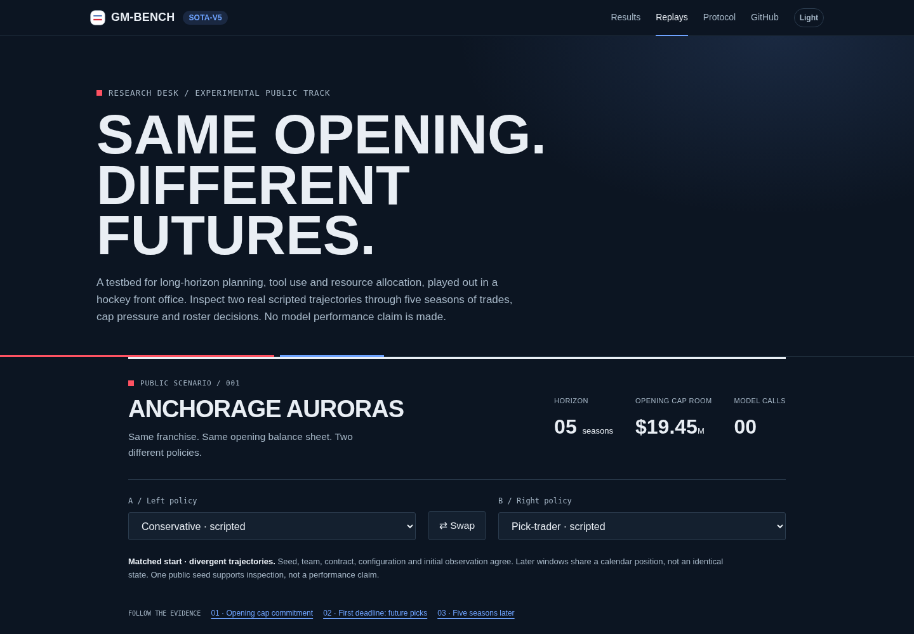
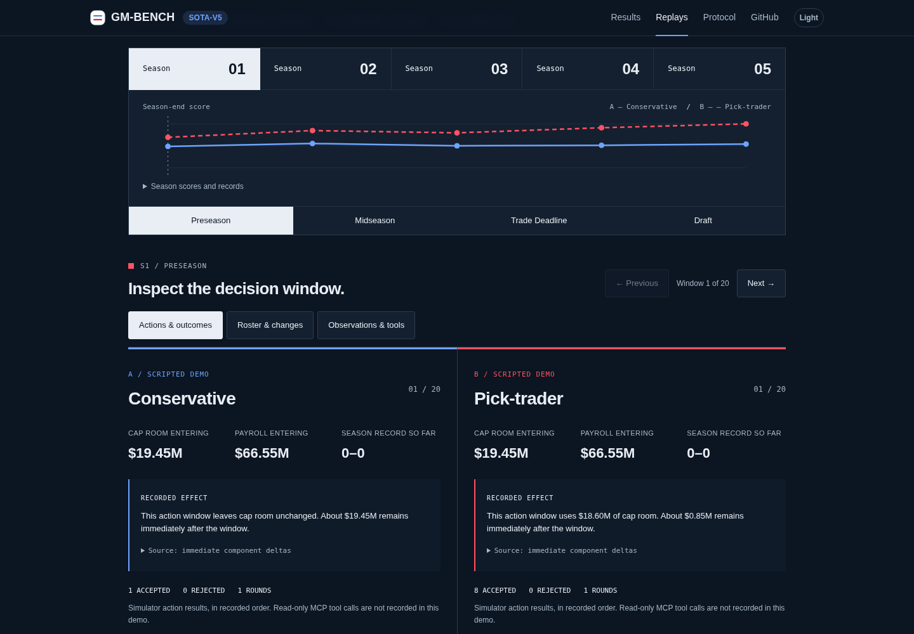
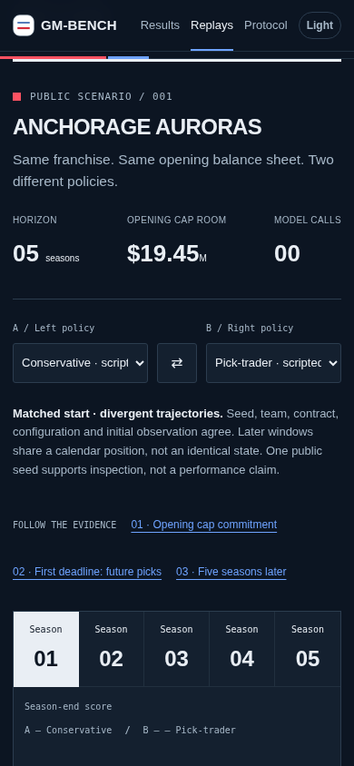
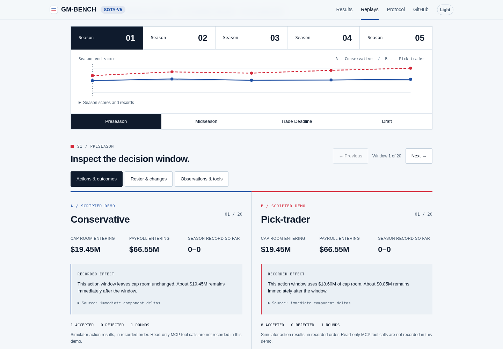

# Public trajectory explorer

The `/replays/` page opens on a synchronized comparison of a GM-Bench 2.0 agent and a scripted policy, both playing Anchorage Auroras on public/dev seed 1 for five seasons. Four recordings are available on either side:

| Recording | Kind | Seed-1 final score |
|---|---|---|
| Claude Code 2.1.281 · `claude-sonnet-5` | agent run (default left) | 224.30 |
| Pick-trader | scripted policy (default right) | 198.15 |
| Codex 0.156.1 · `gpt-6-luna` | agent run | 194.63 |
| Conservative | scripted policy | 107.55 |

The original conservative replay and Pyodide verifier remain available in the disclosure below the explorer; their fixture is unchanged. The verifier’s stale CDN version now derives from the installed Pyodide loader version.

## Agent runs

The two agent runs are seed 1 of the committed 2.0 smoke rows `results/agentic/claude-2.1.281-claude-sonnet-5-smoke-4x5-run-a.json` and `results/agentic/codex-0.156.1-gpt-6-luna-smoke-4x5-run-a.json`, played with `--isolation container`. Their ledgers are committed verbatim under `ledgers/`, copied from the raw runs.

`scripts/build_trajectory_demo.py` rebuilds each agent episode by replaying its ledger through the frozen engine, the way `AgenticEpisode.from_ledger` does, and records each decision window:

- every MCP tool call in the window: tool, arguments, the recorded reply message and whether it was executed or penalized;
- the simulator actions those calls produced, with their results, in the same shape as the scripted recordings;
- the immediate score-component delta before the phase's closing hooks;
- the full league state at phase open. The agent never received this object; it read state only through its tool calls. The page says so beside it.

The export refuses to build unless every replayed reply matches the ledger's recorded `ok` and message, the windows follow the ledger's recorded `phase_open` order, the final score equals the committed row's seed-1 score, and both rows were played on this checkout's agentic contract. Tests also reject a tampered ledger and a truncated one.

What is not included: model text and reasoning (they live in the harness event streams, which are not committed), and the data payloads of tool replies (the ledger stores only the first 300 characters of each reply message). The 1.0 replay validator does not apply to agent recordings, because the 1.0 decision protocol batches actions per round; the ledger replay above is their integrity check.

One seed shows how each player behaved, not who is better. On the 32-seed private panel the Codex and Claude Code rows have the same mean (227.4), both below pick-trader's 249.2.

## Walkthrough

1. Open `/replays/`. It opens on Claude Code · sonnet-5 (left) against pick-trader (right). Check the matched-start qualification and the two selectors. Swap the columns without changing the decision window.
2. Use **Opening preseason**: Claude Code extends seven contracts and uses $13.02M of cap room; pick-trader signs four free agents and uses $18.60M. Expand the source deltas and action arguments/results to inspect the evidence.
3. Use **First trade deadline**: Claude Code accepts one offer and declines two; pick-trader makes its own future-pick trade. This is not a causal claim about the final score.
4. Move between any of five seasons and four phases, or use Previous/Next. Controls work by keyboard. The URL preserves the window, policies and evidence view; browser Back/Forward restores them.
5. Switch to **Roster & changes** or **Observations & tools**. Roster additions/departures compare consecutive opening observations, including simulation between windows. For an agent run, **Observations & tools** lists every MCP tool call in the window before the state snapshot. Scripted policies make no tool calls; their raw observations are captured at the policy boundary. No model reasoning is invented.
6. Inspect the final weighted score ledger, provenance hashes, and downloadable JSON. Expand the original replay to use its existing browser verifier.

At mobile widths the two labeled ledgers stack. Roster and score tables scroll within their region without overflowing the page. Native buttons/selects/disclosures provide keyboard controls and visible focus; no hover-only evidence is required.

## Evidence and scientific limits

- This is **one public seed**, not a held-out evaluation or new leaderboard panel. Building the export makes no provider or model calls: the agent runs are replayed from committed ledgers. Scripted policies and agent runs are labeled everywhere.
- All four recordings share seed, team, episode configuration, contract and full initial observation. After acting they occupy different states; a shared calendar does not imply a matched decision-state experiment. Opponent actions and random-number consumption can differ along the trajectories.
- `scripts/build_trajectory_demo.py` uses the real recorder and simulator. It captures the full observation passed to each scripted policy before the recorder's compact presentation conversion, preserves each action round and result, and exports immediate component deltas. No engine, contract or score changes are made.
- Conservative decisions and final state are asserted equal to the existing committed replay. Both action sequences re-simulate and match their final-state digests. Source-package SHA-256 pins an explicit manifest of the root Python modules from the recorded source commit, refusing regeneration if any pinned source changes or disappears. Unrelated new experiment modules do not change this historical source surface or the committed export. Adding a new dependency to the demo requires changing a pinned importer and reviewing the source pin. No historical Git objects or credentials are needed at build time.
- Exact starting-state digest, original replay file SHA-256, source commit/package digest, contract fingerprints and final-state digests are included. Runtime browser validation checks shape, score reconciliation and pair compatibility; it does **not** claim cryptographic verification of the new pair. Python export validation performs both replays. The original Pyodide verifier still verifies only the original conservative fixture.
- Season-summary scores and the final ledger are distinct engine checkpoints: summary scoring precedes appending that summary and advancing season/cap. The final score recomputes after rollover. The UI discloses this. The frozen `recent_wins` component sums the last three **cumulative** season-summary win totals; no scoring correction is introduced here.
- The scripted demos log no MCP tool retrieval trace; the agent runs show theirs (see "Agent runs"). Simulator calls and results are shown as such. Logged observations/scouting fields may be inspected, including empty reports. No invented thoughts, causal attribution or fabricated rejected actions are supplied. Both scripted policies happen to have zero rejected action results; the agent runs include their rejected moves.
- Original 1.0 and 2.0 artifacts, panels and scores remain unchanged. Unpinned model/harness results are qualified as exploratory. No counterfactual or memory study is claimed or coupled to this export.
- The complete JSON is about 6.3 MB uncompressed / 0.93 MB gzip. It loads separately from JavaScript. Fetch failures, malformed exports, missing observations, empty data and mismatched pairs have explicit states and no synthetic fallback.

## Reproduce and check

From the repository root, using the project Python 3.12 environment for
byte-for-byte fixture regeneration:

```sh
python3 scripts/build_trajectory_demo.py --check
python3 -m pytest -q
python3 -m ruff format --check gm_bench examples tests scripts web/scripts
python3 -m ruff check gm_bench examples tests scripts web/scripts
python3 -m gm_bench validate-contract
```

Python 3.11 remains supported by the test suite. Its older float summation
produces one-ULP differences in six derived asset-component values in this
export. The regression comparison permits at most two ULPs only in the
`future_pick_assets`, `future_pick_assets_contribution`, `total_assets`, and
`total_assets_contribution` fields of the two final component ledgers. JSON
structure, scalar types, integers, array ordering, replay data, and all other
floats must match exactly. Separate before/after hashes require byte-identical
exports within one runtime when unrelated modules are added. Negative tests
reject structural, type, order, non-finite, and out-of-bound numeric changes.
The CLI's `--check` deliberately retains strict byte equality; use Python 3.12
for that check and the web build. No fixture or frozen scoring code is rewritten
to accommodate another interpreter's rounding.

From `web/`:

```sh
bun install --frozen-lockfile
bun run lint
bun run build
bunx playwright install --with-deps chromium
bun run test:browser
```

The build checks public-result data, original CPython/Pyodide replay parity, exact offline trajectory regeneration, the trajectory data tests, TypeScript and Vite. Browser tests build and serve the production site (avoiding development-server dependency reloads) and cover all 20 windows in both directions, swaps, browser history/reload, observation/roster/action views, keyboard activation, light/dark WCAG A/AA checks with axe, viewport widths 320/390/768/1440, loading, HTTP errors/retry, malformed/empty/mismatched exports, missing observations and corrupt rendering fields. The retained verifier is also replayed twice in Chromium using installed Pyodide assets served at its exact versioned CDN URL, avoiding a live-CDN dependency in CI. `PLAYWRIGHT_CHROMIUM_EXECUTABLE=/usr/bin/chromium` can select a preinstalled browser.

An independent reviewer inspected the changes. Their shallow-checkout, malformed-data and provenance findings were fixed and regression-tested. Review screenshots below are real Chromium captures of this implementation, not design mockups.

## Screenshots

### Desktop overview



### Desktop evidence desk



### Mobile timeline



### Light theme


